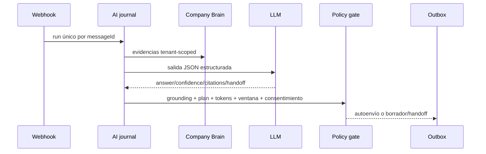

# IA conversacional

## Modos

- `AI`: puede auto-responder solo si todas las validaciones pasan.
- `HYBRID`: genera borrador; el umbral de autoenvío es deliberadamente más estricto.
- `HUMAN`: no ejecuta IA.
- `PAUSED`: pausa IA sin cerrar el hilo.
- `CLOSED`: detiene atención y cierra la conversación.

## Pipeline

La respuesta se valida con Zod, citas y cobertura de evidencia. Sin grounding suficiente se convierte en borrador o handoff; nunca se rellena con una respuesta no soportada. Los runs registran proveedor/modelo/tokens/intentos/error/decisión y son idempotentes.

## Proveedores

- `platform`: usa el resolver de modelos/entitlements existente.
- `openai-compatible`: base URL, modelo y API key cifrada por tenant. Solo HTTPS (salvo localhost en desarrollo); hosts privados se rechazan salvo allowlist exacta para evitar SSRF.

## Límites

`daily_token_limit` y `monthly_token_limit` existen en el modelo; el ledger de uso de plataforma se registra. La promoción exige una prueba real que confirme enforcement concurrente de los topes, calidad/coste por modelo y comportamiento al agotar créditos. Hasta entonces IA debe activarse por tenant y en canary.
