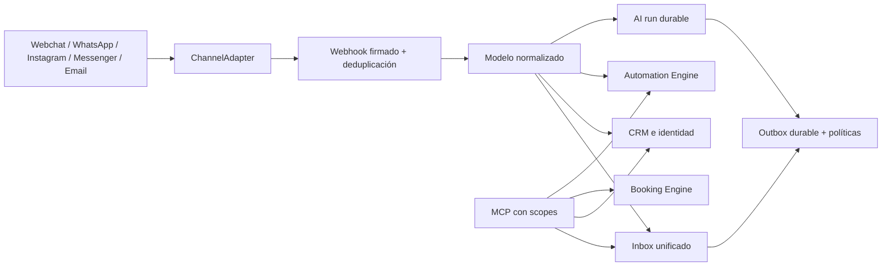

# Arquitectura omnicanal

## Decisión

La plataforma amplía el monolito modular existente; no sustituye autenticación, CRM, Company Brain, reservas, automatizaciones, billing, MCP, observabilidad ni el widget. El dominio nuevo vive en `lib/channels`, las rutas en `app/api/{portal,public,webhooks,cron}` y la UI en el portal existente.

## Reutilización verificada

| Capacidad | Componente reutilizado | Extensión |
|---|---|---|
| Auth/RBAC/tenant | `authorizePortal`, `PortalMcpContext`, `clientId` | scopes `chat:*`, `crm:*`, `bookings:*`, `automations:*` |
| CRM | contactos, actividades, tags, deals | identidades por canal y merge explícito |
| Chat | widget, conversaciones, mensajes, SSE | esquema normalizado y multi-canal |
| Company Brain | búsqueda/citas y gate de plan | respuesta estructurada y validada |
| AI/BYOK | resolución de proveedor, uso y Sentry | configuración OpenAI-compatible por tenant |
| Automatización | event bus, reglas, jobs y scopes derivados | triggers/actions conversacionales |
| Reservas | disponibilidad, capacidad, asignación, asistentes | herramientas MCP sin bypass de pago |
| Billing | entitlements y usage ledger | consumo IA registrado; catálogo comercial pendiente |
| MCP | servidor, API keys, scopes, auditoría/telemetría | 28 herramientas omnicanal |

## Fronteras

- Cada consulta mutable se filtra por `clientId`; identificadores externos nunca deciden el tenant sin resolver primero una conexión única.
- El webhook de Meta es único por app. La firma se verifica sobre bytes crudos antes de parsear; después se resuelve `phone_number_id` o `entry.id` a una sola conexión.
- Ingreso, decisión IA y salida son diarios durables e idempotentes. Los crons recuperan trabajos atascados.
- La IA propone; las políticas deterministas de consentimiento, ventana, tenant, plan y booking conservan la autoridad.
- El widget conserva un `iframe` aislado. Es una frontera CSS/origen más fuerte que Shadow DOM y mantiene compatibilidad con el embed existente.

## Inventario añadido

- Adaptadores: Meta (WhatsApp, Messenger, Instagram), webchat y email saliente.
- API: gestión de canales, OAuth/selección de activos Meta, webhook Meta, configuración IA, carga segura del widget y dos workers cron.
- UI: ajustes de canales/IA, inbox multi-canal, controles AI/HUMAN/PAUSED/HYBRID y borradores revisables.
- Persistencia: conexión, identidad, consentimiento, webhook journal, outbox, auditoría y AI run.

## Decisiones diferidas

- No se introdujo Kafka/SQS: el outbox PostgreSQL es suficiente para preservar atomicidad en esta arquitectura; un broker será decisión de capacidad tras medir p95/p99 y backlog.
- Email entrante no se conecta a un proveedor nuevo: la base saliente está integrada, pero la ingestión debe adaptarse al webhook ya elegido por la operación.
- No se declara microservicio separado ni reescritura del frontend.
